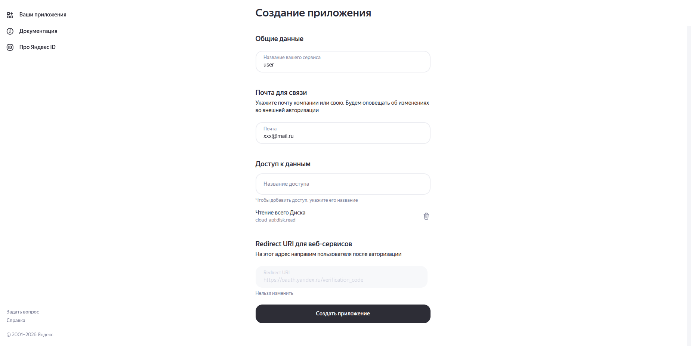
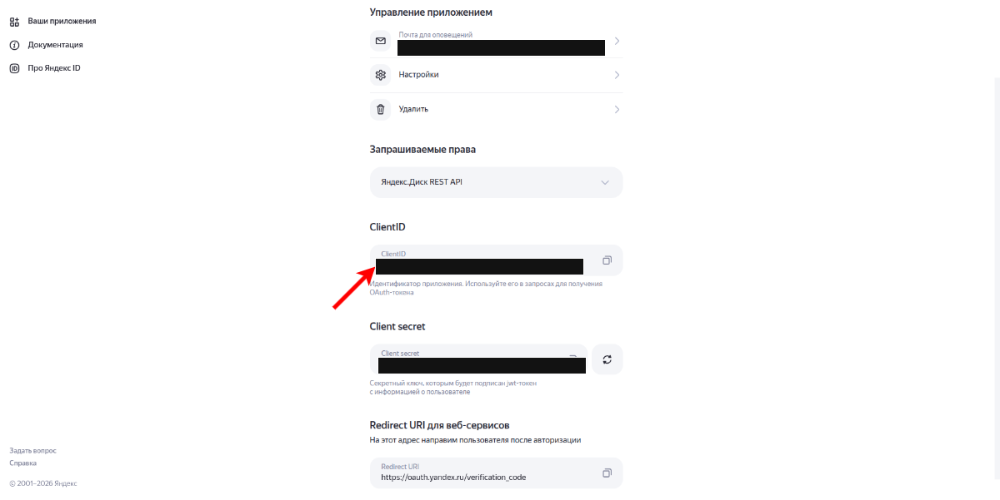

# Выгрузка из Яндекс Диска

Локальное веб-приложение для массового асинхронного скачивания файлов и папок
из Яндекс Диска на локальный диск с сохранением структуры вложенных каталогов.

Стек: **Python 3 (FastAPI + Asyncio) + Vanilla ES6 JS + CSS** — работает нативно на Windows.

---

## Возможности

- **Подключение диска по OAuth-токену**: через веб-форму (implicit-флоу) либо автоматически при старте через переменную `YANDEX_TOKEN` в `.env`.
- **Просмотр структуры диска**: папки, файлы, размеры, даты изменения, пагинация (по 1000 элементов); удобный мультивыбор чекбоксами (одной папки, нескольких папок или отдельных файлов).
- **Выбор папки назначения**:
  - Нативное диалоговое окно проводника Windows (кнопка **«📁 Обзор…»**).
  - Ручной ввод пути (поддерживается скачивание в **любое место** компьютера: `C:\Downloads`, `D:\Backups`, внешние накопители).
- **Умное докачивание (Smart Resume)**: при повторном запуске скачивания файлы, которые уже есть на диске и имеют совпадающий размер, автоматически пропускаются — докачиваются только отсутствующие файлы.
- **Фиксация сбойных файлов**: если часть файлов не удалось загрузить из-за сбоев серверов Яндекса (ошибки 502, 429 или таймауты CDN), в папке назначения автоматически формируется файл-отчёт `_failed_downloads.txt` со списком неоткачанных файлов и причинами сбоя.
- **Параллельные загрузки и Rate Limiting**: настраиваемое число воркеров (по умолчанию 8), глобальный лимит частоты запросов к API (`API_QPS`), автоматические повторы (retries) на ошибках 429/5xx с соблюдением `Retry-After`.
- **Защита от повреждённых копий**: проверка ожидаемого размера файла (`expected_size`) против байтов, отданных CDN Яндекса, защита от усечённых файлов.
- **Живой мониторинг**: прогресс-бар, число файлов, байты, живой расчёт скорости (КБ/с, МБ/с), мгновенная отмена выгрузки с очисткой временных `.part`-файлов.
- **Логирование**: запись подробных логов в файл `logs/app.log` с ротацией.
- **Тёмная тема**: поддержка светлого и тёмного оформления интерфейса с сохранением выбора.
- **История задач**: последние 50 выгрузок, кнопка «Повторить неудавшиеся» в один клик.

---

## Запуск

### 1. Создайте OAuth-приложение Яндекса (нужен Client ID)

1. Откройте <https://oauth.yandex.ru/>:

   

2. Нажмите «Создать OAuth-приложение»:

   

3. Скопируйте **Client ID**:

   

> **Client Secret** для этого приложения **не нужен** и нигде не хранится (используется безопасный implicit-флоу `response_type=token`).

### 2. Настройте окружение

Скопируйте файл примера:

```powershell
cp .env.example .env
```

Откройте `.env` и впишите ваш `YANDEX_CLIENT_ID`:

```ini
YANDEX_CLIENT_ID=ваш_client_id_здесь

# Опционально: можно сразу прописать токен, чтобы не вставлять его в браузере:
# YANDEX_TOKEN=y0_AgAAAA...
```

### 3. Установите зависимости и запустите

```powershell
pip install -r requirements.txt
python run.py
```

Приложение автоматически запустится и откроет браузер по адресу <http://127.0.0.1:8080>:


1. Нажмите «получить токен» (откроется авторизация Яндекса),
2. Скопируйте токен из адресной строки и вставьте в форму (если не указали `YANDEX_TOKEN` в `.env`),
3. Выберите нужные папки или файлы, нажмите **«📁 Обзор…»** для выбора папки на диске и нажмите **«Скачать выбранное»**.

---

## Параметры конфигурации (`.env`)

| Переменная | По умолчанию | Описание |
| :--- | :--- | :--- |
| `YANDEX_CLIENT_ID` | — | Client ID OAuth-приложения (для ссылки получения токена) |
| `YANDEX_TOKEN` | — | OAuth-токен диска (если задан, подключается автоматически) |
| `DOWNLOAD_ROOT` | `./downloads` | Папка по умолчанию для относительных путей |
| `DOWNLOAD_CONCURRENCY` | `8` | Число параллельных потоков скачивания |
| `API_QPS` | `8` | Общий лимит запросов к API Яндекса (запросов/сек) |
| `FORCE_IPV4` | `1` | Принудительный IPv4 (защита от сетевых сбоев DNS IPv6) |
| `HOST` | `127.0.0.1` | Адрес прослушивания сервера |
| `PORT` | `8080` | Порт локального веб-сервера |

---

## Как это устроено

```
Браузер (HTML5 + Vanilla ES6 + стили Яндекс Диска, порт 8080)
   │  /api → маршруты FastAPI
FastAPI / Uvicorn (единый асинхронный процесс Python)
   │  DownloadManager (asyncio)
   ├─► asyncio.Semaphore (контроль воркеров: 8 параллельных скачиваний)
   ├─► RateLimiter (ограничение QPS без Redis)
   ├─► YandexClient (httpx.AsyncClient, стриминг в .part файлы, авторетраи)
   ├─► Logging (запись в logs/app.log с ротацией)
   └─► SQLite (var/db.sqlite3 — сохранение аккаунта, задач и ошибок)
```

- **Файлы пишутся безопасно**: стриминг идёт во временный файл `.part`, после полной проверки целостности файл атомарно переименовывается в целевой путь (`os.replace`).
- **Никаких половинчатых файлов**: при отмене задачи незавершённые `.part`-файлы мгновенно удаляются.
- **Гибкая настройка воркеров**: число параллельных потоков можно задавать глобально в `.env` или менять на лету прямо в интерфейсе перед запуском выгрузки.

---

## Тесты

Проект снабжён набором из 34 автотестов, проверяющих логику API, скачивание, умное докачивание, генерацию отчётов об ошибках и клиент Яндекса:

```powershell
pytest
```
